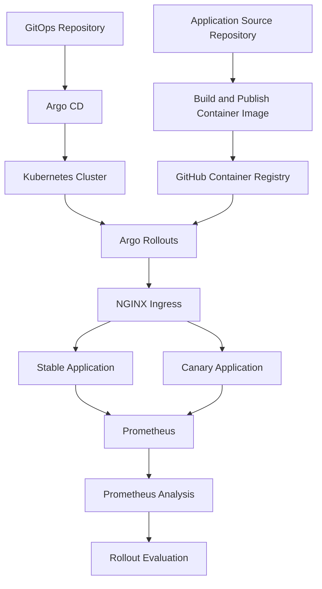

# SmartRelease — GitOps & Progressive Delivery

**A Kubernetes-based DevOps project demonstrating Canary releases, GitOps deployment, and Prometheus-based analysis.**

[Application Repository](https://github.com/KHsalma123/smartrelease-app) · **GitOps Repository**

---

## Overview

SmartRelease is a hands-on DevOps project designed to demonstrate how application releases can be delivered progressively on Kubernetes rather than exposing every user to a new version at once.

The project combines **Argo CD**, **Argo Rollouts**, **NGINX Ingress**, and **Prometheus** to manage deployment configuration, control Canary traffic, and evaluate application request metrics during a rollout.

This repository contains the Kubernetes configuration for the GitOps and progressive delivery side of SmartRelease. The application source code and container build configuration are maintained separately.

## Key Features

- **GitOps delivery with Argo CD** — maintain deployment configuration in Git and reconcile the cluster with the declared state.
- **Canary deployments with Argo Rollouts** — introduce a new application version gradually.
- **Progressive traffic routing** — configure Canary traffic stages at 20% and 50%, with pauses for validation.
- **Prometheus-based analysis** — evaluate an HTTP request success-rate metric against a configured threshold.
- **Kubernetes health checks** — use readiness and liveness probes to monitor application health.
- **Container image delivery through GHCR** — deploy an application image hosted on GitHub Container Registry.
- **Resource management** — define CPU and memory requests and limits for the application container.

## Architecture



### Component Responsibilities

| Component | Responsibility |
|---|---|
| GitHub | Hosts the application and GitOps repositories. |
| GitHub Container Registry (GHCR) | Stores the application container image. |
| Argo CD | Synchronizes Git-managed Kubernetes resources with the cluster. |
| Kubernetes | Runs and manages application workloads. |
| Argo Rollouts | Orchestrates the progressive Canary rollout. |
| NGINX Ingress | Routes traffic between stable and Canary versions. |
| Prometheus | Collects application metrics and evaluates the configured success-rate query. |

The application image build and publication process is separate from the rollout orchestration described in this repository.

## Repository Structure

```text
smartrelease-gitops/
└── kubernetes/
    ├── analysis-template.yaml
    ├── deployment.yaml
    ├── ingress-canary-test.yaml
    ├── rollout-test.yaml
    ├── service-canary-stable.yaml
    ├── service-canary-test.yaml
    └── service.yaml
```

| File | Description |
|---|---|
| `rollout-test.yaml` | Defines the Canary Rollout, replicas, container image, health probes, resource limits, traffic stages, and analysis reference. |
| `analysis-template.yaml` | Defines the Prometheus query and success-rate evaluation criteria. |
| `ingress-canary-test.yaml` | Configures the Ingress resource used for Canary traffic routing. |
| `service-canary-stable.yaml` | Exposes the stable application version inside the cluster. |
| `service-canary-test.yaml` | Exposes the Canary application version inside the cluster. |
| `service.yaml` | Defines an additional application Service. |
| `deployment.yaml` | Contains a standard Kubernetes Deployment configuration. |

## Canary Release Strategy

The current `rollout-test.yaml` defines two application replicas and the following progression:

| Stage | Configured behavior |
|---|---|
| Initial state | Run the application with two replicas. |
| Canary stage 1 | Set the Canary traffic weight to 20%. |
| Analysis | Run the `smartrelease-success-rate` analysis template. |
| Validation pause | Pause the rollout at a checkpoint. |
| Canary stage 2 | Increase the configured Canary traffic weight to 50%. |
| Validation pause | Pause again before further rollout decisions. |

The manifest defines the 20% and 50% stages and pauses. Final promotion to 100% is not declared as a separate step in this file and may require a subsequent rollout action.

## Prometheus-Based Analysis

The `analysis-template.yaml` file defines an `AnalysisTemplate` named `smartrelease-success-rate`.

It queries Prometheus using the `http_requests_total` metric to calculate the ratio of successful HTTP 2xx request rates to total measured request rates, excluding requests handled by `/metrics`.

### Analysis Configuration

| Parameter | Configured value |
|---|---|
| Success-rate threshold | 95% (`result[0] >= 0.95`) |
| Measurement interval | 30 seconds |
| Number of measurements | 3 |
| Failure limit | 1 |
| Metrics provider | Prometheus |
| Metrics endpoint excluded | `/metrics` |

The configured success condition is:

```text
result[0] >= 0.95
```

The analysis is intended to help evaluate the release using observed request metrics. Its reliability depends on Prometheus collecting the intended stable and Canary workloads and on the query returning valid data.

## Application Health and Resource Configuration

The Canary Rollout configures the following health checks and resource limits for the application container.

| Setting | Value |
|---|---|
| Readiness endpoint | `/health` |
| Readiness initial delay | 3 seconds |
| Readiness period | 5 seconds |
| Liveness endpoint | `/health` |
| Liveness initial delay | 5 seconds |
| Liveness period | 10 seconds |
| CPU request | `100m` |
| CPU limit | `500m` |
| Memory request | `128Mi` |
| Memory limit | `256Mi` |

These probes help Kubernetes determine when the application is ready to receive traffic and whether the container should be restarted.

## Prerequisites

To reproduce the deployment, prepare:

- A Kubernetes cluster.
- `kubectl`.
- Argo CD.
- Argo Rollouts and its `kubectl` plugin.
- An NGINX Ingress Controller compatible with the configured routing.
- Prometheus configured to scrape the application metrics.
- Git access to this repository.
- Access to the application image in GHCR and an image-pull secret if the package is private.

The Prometheus service address and Kubernetes resource names in the manifests must match your environment.

## Deployment and Validation

After configuring the prerequisites and applying or synchronizing the appropriate resources, use the following commands to inspect the deployment.

### Check the cluster

```bash
kubectl get nodes
```

### Check the Argo CD application

```bash
kubectl get application smartrelease -n argocd
```

### Inspect the Canary rollout

```bash
kubectl argo rollouts get rollout smartrelease-canary-test
```

### Inspect workloads and services

```bash
kubectl get pods
kubectl get services
kubectl get ingress
```

### Inspect analysis resources

```bash
kubectl get analysistemplate,analysisrun
```

These commands help verify cluster readiness, GitOps synchronization, rollout health, traffic-routing resources, and analysis execution.

### Failure and Rollback Validation Lab

A separate Rollout named `smartrelease-failure-lab` was used to
validate failure detection and rollback behavior in the
`smartrelease-lab` namespace. This lab is managed independently
from the main Argo CD application.

The validation included:

- Verifying that the application `/metrics` endpoint returns HTTP 200.
- Confirming that Prometheus successfully scrapes the lab workloads.
- Triggering a failed analysis using a dedicated failure-test
  AnalysisTemplate.
- Confirming that the failed candidate revision is scaled down.
- Restoring the stable application image:
  `ghcr.io/khsalma123/smartrelease-app:metrics-80ae579`.
- Verifying that the final Rollout is Healthy with 2/2 replicas ready.

Useful inspection commands:

```bash
kubectl argo rollouts get rollout smartrelease-failure-lab -n smartrelease-lab
kubectl get pods -n smartrelease-lab
kubectl get analysistemplate -n smartrelease-lab
```

The forced-failure AnalysisTemplate is intended for demonstration and testing; it is not the normal production success-rate analysis.

## Related Repository

The application code and container build configuration are maintained in a separate repository:

**[SmartRelease Application — smartrelease-app](https://github.com/KHsalma123/smartrelease-app)**

This separation keeps application development and containerization distinct from Kubernetes deployment configuration and progressive delivery.

## Project Objectives

SmartRelease demonstrates practical experience with:

- Kubernetes workload configuration.
- GitOps principles and declarative delivery.
- Progressive delivery using Canary releases.
- Traffic management with NGINX Ingress.
- Metrics-based rollout analysis with Prometheus.
- Container health checks and resource management.
- Separation of application source code and deployment configuration.

## Author

Developed as a hands-on DevOps portfolio project focused on Kubernetes, GitOps, progressive delivery, and observability.
